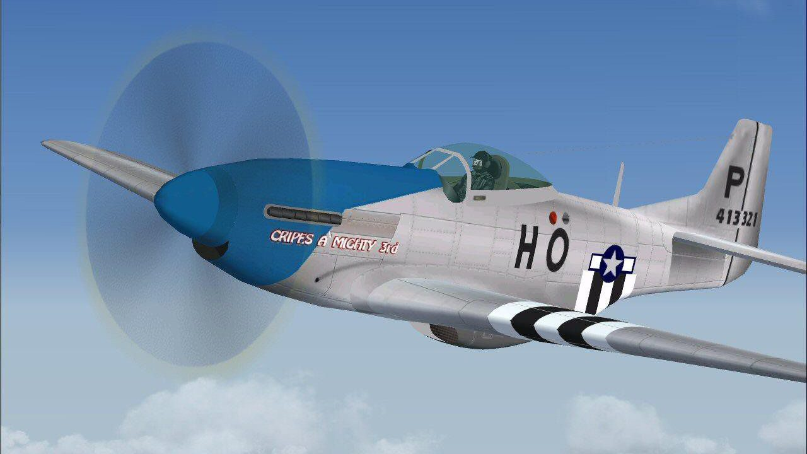

# Chalenge's Sick Puppy Sound Pack for Aces High III



## In memory of Chalenge

Chalenge made the Sick Puppy Sound Pack for Aces High III and gave it to the community in 2019. He died in
November 2022. The sounds here are his: every plane he covered plays his engines, and the planes added since are
built on his designs.

This copy has been repaired and filled in so it can keep being flown. It is shared with the blessing of Fuji
(The Fugitive), his XO, and of his squadmates, who asked only one thing: that it is always known as
**Chalenge's sound pack**.

## Download

Get **SickPuppySounds-fixed-v17.zip** from the [Releases](../../releases) page.

## Install

1. Close Aces High III.
2. In your Aces High III folder (the one with the game's .exe), make a folder `CustomSounds`, and inside it a folder
   `Desktop`:

   ```
   <your Aces High III folder>\CustomSounds\Desktop\
   ```

3. If that `Desktop` folder already has another sound pack in it, move those files somewhere safe first.
4. Copy the four `.bank` files from the zip into the `Desktop` folder: `CustomDefault.bank`,
   `CustomDefault.strings.bank`, `CustomEffects.bank` and `CustomMusic.bank`. All four go in together.
5. Start the game. There's no setting to switch on.

**Back to stock sounds:** delete or rename the `CustomSounds\Desktop` folder and restart the game.

## What's been fixed

- Levels evened out between planes, so the one "your engine" slider works for all of them; cruise matches stock.
- 64 engine loops that clicked or pumped at the loop point repaired.
- Planes that come into view already flying no longer play a start-up first.
- Start-ups and shut-downs capped at each engine's full-throttle level; WEP clearly audible.
- Every sound stops when the game switches it off: no more "... not stopping" messages in the text buffer.
- The M4A3(76) tracks follow the tank's speed.
- About 50 planes the original pack didn't cover now have engines; the WWI planes stay on stock sounds.

## Credits

- **Chalenge**: the Sick Puppy Sound Pack, all of its original sounds, events and design.
- **Mitsu**: engine loops from Mitsu's Sounds Collection (Aces High II) for the planes Chalenge's pack lacks.
- **The recordists of the IL-2 1946 "412 Soundpack"**: the Tu-2S, Me 262, Ar 234 and C.205 engines. The pack
  doesn't name them and we couldn't find out who they were. We salute and thank them, and we'll gladly add their
  names if they make themselves known.
- Fixes and additions: Steely.

Aces High III is by HiTech Creations. Full credits are in `CREDITS.txt` inside the zip.
